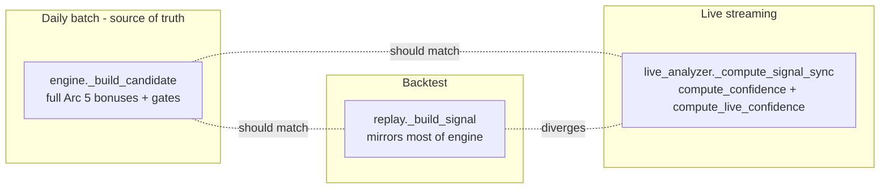

# Engine Parity & Prediction-Quality Improvements Plan

> **Companion to** `.cursor/plans/shorts-recovery-plan_fb6be623.plan.md`. That plan covers the
> separate shorts engine. THIS plan covers the non-shorts issues found in the 2026-06-03 codebase
> scan. The two plans share one prerequisite (regime taxonomy unification) — do it once, both benefit.

**Goal:** Make the live recommendation path, the daily batch engine, and the backtest replay produce
consistent, comparable signals; close the largest correctness and parity gaps; and add the missing
test scaffolding so future changes are safe.

**Scope note:** This is a phased plan with file/line anchors and acceptance gates, not line-by-line
TDD. Each phase is independently shippable and ordered by impact on prediction quality.

---

## Background: three signal paths that have drifted apart

The app scores the same asset in three places that are supposed to agree but do not:

- **Batch engine** (`engine.py:_build_candidate`, ~1148-1960): the full model — Arc 5 confidence
  bonuses, soft-penalty pool, hard gates (crisis/high_vol, RSI exhaustion, OFI, earnings, conflict),
  market-context adjustments, policy scaling.
- **Replay** (`replay.py:_build_signal`, 204-521): mirrors most Arc 5 bonuses and soft penalties, but
  is missing several hard gates and adjustments (see Phase 3).
- **Live** (`live_analyzer.py:_compute_signal_sync`, 293-447): does **not** run engine scoring at all.
  It blends `compute_confidence()` with `compute_live_confidence()` (a backtest-win-rate blend,
  `live_confidence.py:86-125`) and applies almost none of the Arc 5 bonuses or hard gates.

Net effect: a trade shown live can be one the batch engine would never recommend, and backtest
metrics (which feed `compute_live_confidence`) describe a fourth, slightly different population.

---

## Phase 0: Regime Taxonomy Unification (SHARED PREREQUISITE)

Identical to Phase 4.5 in the shorts plan — track it in one place, not two.

**Problem:** three regime taxonomies that do not align:
- Live 3-label `MarketRegime.regime` ∈ {risk_on, risk_off, cautious} — `market_context.py:89`
- Live 5-label `MarketRegime.extended_regime` ∈ {crisis, high_vol, bull, bear, neutral} — `market_context.py:97-117`
- Backtest `day_regime` ∈ {crisis, high_vol, bull, bear, neutral} (no risk_off) — `regime.py`

**Defects:**
- **`bear` is structurally inverted on VIX between live and backtest — NOT just a threshold offset.**
  Live `extended_regime` (`market_context.py:113-116`) defines `bear` = bearish trend **AND VIX < 25**
  (it is the fall-through after the crisis≥35 / high_vol≥25 checks). Backtest `regime.py:64` defines
  `bear` = SPX below 200-SMA **AND VIX ≥ 20**. The VIX conditions point opposite directions: a day
  with SPX falling and VIX in [25,30) is `high_vol` live but `bear` in backtest. For the shorts engine
  this is a direct conflict — the same day is short-**blocked** in one path and short-**eligible** in
  the other. Aligning the threshold *numbers* (next bullet) does not fix this; the boolean rule itself
  must be unified.
- **`spx_trend` uses different SMAs across paths.** Live requires price below **both** SMA50 and SMA200
  to be "bearish" (`market_context.py:141-146`); backtest `bear` uses **only** the 200-SMA
  (`regime.py:64,84-100`). The canonical helper must standardize the trend definition, not just VIX.
- VIX thresholds differ: extended_regime crisis≥35/high_vol≥25 vs backtest crisis≥40/high_vol≥30.
- `determine_direction()` / `compute_confidence()` only branch on the 3-label scheme
  (`technicals.py ~1195-1240`); replay feeds them 5-label strings that silently fall back to defaults.
- **The dead `== "bear"` / 5-label-vs-3-label branch exists in THREE live locations, not one:**
  - `engine.py:1252` and `engine.py:1798` compare `regime.regime == "bear"` — 3-label, never "bear".
  - `live_analyzer.py:354,357` short gates check `regime in ("crisis","high_vol")` and
    `regime == "bear"`, but `build_all_signals` feeds them `ctx.regime` (3-label, line 464) — both
    gates can never match. The crisis/high_vol short block and the bear exception are dead in live.
  - `stream_processor.py:379,393`: `_get_regime_summary()` (line 962) returns `regime.regime` (3-label),
    so `_regime_label == "bear"` is always false — the bear-regime short floor exception is dead here too.

**Tasks:**
1. Introduce a single regime-mapping helper (e.g. `app/services/regime_map.py`) that converts any
   taxonomy to one canonical label set and is the only place thresholds **and the trend/`bear` boolean
   rule** live.
2. Align VIX thresholds **and unify the `bear` definition** (trend rule + VIX direction) between
   `market_context.py` and `regime.py` so the same day gets the same canonical label.
3. Make `determine_direction` / `compute_confidence` accept the canonical labels (map 5→weight buckets).
4. Replace ALL dead 5-label-vs-3-label comparisons — not only `engine.py:1252,1798`, but also the
   `live_analyzer.py` short gates (feed them the canonical/extended label, not `ctx.regime`) and the
   `stream_processor.py` short floor (`_regime_label` must come from the extended label).
5. **Test:** a fixed VIX/SPX fixture yields the same canonical label in live and backtest for every day —
   asserting the same **boolean label** across paths (esp. the bear/high_vol boundary), not just matching
   threshold constants.

**Acceptance:** one regime helper, one set of thresholds **and one `bear`/trend rule**, no taxonomy-specific
string literals scattered across engine/replay/live/stream_processor; the bear/high_vol boundary classifies
identically in live and backtest; regression test green.

### LOCKED DESIGN (2026-06-05 brainstorming — ready to implement)

**Decisions locked:** (1) re-baseline now — consuming the 5-label moves Sharpe 3.114, walk-forward is the gate;
(2) canonical = `regime.py` rules; (3) dedicated bear/neutral profiles (bull inherits risk_on);
(4) scoring consumes the 5-label only, 3-label kept for UI + the engine risk_off long→short flip.
**Approach A:** new `app/services/regime_map.py` = classifier + profile accessors; `regime.py`,
`market_context.extended_regime`, and the four `technicals._regime_*` functions all delegate to it.

**§1 Module shape.** `regime_map.py` exposes:
- `classify_canonical_regime(vix: float|None, spx_vs_sma200: float|None) -> str` → `crisis|high_vol|bear|bull|neutral`
- `direction_weights(label)`, `tech_weights(label)`, `rsi_thresholds(label)`, `stoch_thresholds(label)` → the profile tuples.

**§2 Classification rule** (lifted verbatim from `regime.py:39-69`, priority order, first match wins):
`vix≥40→crisis · vix≥30→high_vol · (spx_vs_sma<0 AND vix≥20)→bear · (spx_vs_sma>0 AND vix<20)→bull · else→neutral`.
None-handling made explicit: a `None` vix or `None` spx_vs_sma collapses to `neutral` (matches regime.py fall-through;
backtest calendar unchanged).

**§3 Profiles — 5 labels → 4 buckets** (`crisis`/`high_vol` are hard-blocked before scoring, so they reuse the
most-defensive `bear` bucket as a safety net):

| Canonical label | bucket | dir (sent,tech) | tech (trend,MR) | rsi (bull,bear,OB,OS) | stoch (bull,bear,OB,OS) |
|---|---|---|---|---|---|
| bull | risk_on (inherited) | 0.20 / 0.80 | 1.2 / 0.85 | 52/48/72/28 | 52/48/85/15 |
| neutral | neutral (NEW) | 0.30 / 0.70 | 0.95 / 1.10 | 55/45/70/30 | 55/45/80/20 |
| bear | bear (NEW) | 0.32 / 0.68 | 0.78 / 1.28 | 63/37/60/40 | 63/37/72/28 |
| crisis / high_vol | → bear | (reuses bear values) | | | |

NEW-bucket rationale: **neutral** nudges tech toward mean-reversion (0.95/1.10) vs old default's 1.0/1.0;
**bear** is deliberately stricter than old risk_off — more sentiment weight (a long needs tech *and* news),
stronger MR tilt (only oversold bounces qualify in a downtrend), tighter bars. Values are calibration
starting points; the structure (bear stricter than neutral stricter than risk_on for longs) is the contract,
the decimals are what walk-forward tunes.

**§4 Call-site changes:**
- *Tier 1 — `technicals.py`:* the four `_regime_*` functions (`:1195/1208/1220/1232`) stop branching on
  `risk_on/risk_off` strings and delegate to `regime_map` accessors keyed on the 5-label. Signatures unchanged;
  internal consumers (`:1276/1284/1303/1383/1453`) need no edits.
- *Tier 2 — feeds switch to 5-label:* `live_analyzer.py:464` `regime = ctx.regime` → `ctx.extended_regime`
  (currently feeds 3-label all the way into `determine_direction`:337 / `compute_confidence`:387);
  `replay.py:260` already passes `day_regime` (5-label) — now actually consumed instead of silently defaulting;
  engine scorer feeds switch to `extended_regime`.
- *Tier 3 — dead branches now reachable:* `engine.py:1252` & `:1798` `regime.regime=="bear"` → `extended_regime=="bear"`;
  `stream_processor.py:958` `_get_regime_summary` returns `extended_regime` so `:379-384` `_regime_label=="bear"` can match;
  `engine.py:1208` already uses `extended_regime` ✓.
- `market_context.extended_regime`(`:98`) rewritten to delegate to `regime_map.classify_canonical_regime()` — this is
  what fixes the inverted-VIX-bear discrepancy.

**§5 Re-baseline + validation.** Phase 0 ships unflagged (correctness fix), but measured before/after. Full
walk-forward re-run → new Sharpe/WR/avg-R/maxDD/degradation become the new locked baseline (record old+new
side-by-side). Acceptance bar: degradation ratio stays ≤ ~1.1 (currently 1.019) and Sharpe regresses no more
than a stated tolerance; if bear/neutral profiles hurt, tune the §3 decimals (structure stays).

**§5 RESULT (2026-09-17) — PASSED.** Identical config both runs: 2023-05-26→2026-05-26, IS 252 / OOS 63,
conf 40, moderate, 7 windows. Baseline = stored WF run `6963a1e4` (pre-Phase-0). NEW LOCKED BASELINE below.

| OOS metric | Baseline (pre) | Phase 0 (new) | Δ |
|---|---|---|---|
| Sharpe | 1.699 | **2.845** | +67% |
| Avg P&L (R) | 0.0671 | 0.1053 | +57% |
| Win rate | 31.71% | 32.60% | +0.9pp |
| Total R | 285.9 | 597.1 | +109% |
| Max DD (R) | 250.1 | 224.0 | −10% (better) |
| Trades | 4,260 | 5,672 | +33% |
| Degradation | 1.0193 | **1.0445** | still "robust" (≥0.85), OOS>IS |

IS side for the record: Sharpe 1.679→2.762, avg-R 0.0658→0.1036, trades 17,739→22,488, MaxDD 289→353,
total-R 1167→2330. Acceptance met on all three gates (degradation ≤1.1 ✅, Sharpe up not down ✅, robust ✅).
The +33% OOS trades is the expected mechanism: pre-fix bull days silently used the `default` profile; post-fix
they use the more-lenient `risk_on` profile → more candidates pass, and they pass *profitably*. Bear/neutral
profiles required NO tuning. Note: run was direct `run_walkforward_backtest()` (console), NOT persisted to the
walkforward_runs table — so it does not show on the backtest page.

**§6 Testing.** (a) `regime_map` unit tests — table over the priority ladder + the three None-collapse cases;
(b) cross-path regression — same VIX/SPX series → identical label via live (`market_context.extended_regime`) and
backtest (`regime.classify_regime`), explicit cases on the bear/high_vol boundary (VIX 25-30, SPX falling) and the
VIX-20 bear edge; (c) profile-wiring — each label resolves to the expected bucket (bull→risk_on, crisis/high_vol→bear).

---

## Phase 1: Unify scoring across batch / replay / live (HIGH)

**Problem:** `live_analyzer.py` re-implements a reduced scoring model. Missing vs `engine.py`
(present in engine, and mostly in replay):

| Adjustment | engine.py | replay.py | live_analyzer.py |
|---|---|---|---|
| MACD+RSI dual alignment (+6) | 1442-1451 | 340-344 | missing |
| Volume surge (+5) | 1453-1458 | 345-346 | missing |
| RSI momentum (+4) | 1460-1468 | 347-352 | missing |
| Triple confluence (+5) | 1470-1479 | 353-358 | missing |
| ATR percentile (±3) | 1481-1488 | 359-364 | missing |
| Turn-of-month (+2) | 1490-1495 | 365-368 | missing |
| 52w high proximity (+8/+4) | 1497-1507 | 369-374 | missing |
| EMA200 sweet spot (±3) | 1509-1528 | 375-387 | missing |
| MTF alignment bonus | 1554-1555 | 407-434 | missing |
| Crisis/high_vol hard block | 1205-1209 | 228-231 | **missing (live never blocks)** |
| RSI exhaustion hard gate | 1267-1287 | missing | missing |
| OFI gates | 1533-1553 | missing | missing |
| Stale snapshot penalty | 1175-1177 | n/a | missing (is_stale set, not consumed) |

**Approach:** extract the post-`compute_confidence` adjustment pipeline from `_build_candidate` into a
shared, pure function — `score_candidate(snapshot, direction, regime, policy, context) -> ScoreResult`
— and call it from all three paths. Replay and live become thin adapters.

**Decision (locked): Option A — full live parity.** Live routes through the shared scorer and receives
the exact same bonuses, soft penalties, and hard gates as the daily batch engine. A live signal is
therefore one the batch engine would also produce. The historical-win-rate blend
(`compute_live_confidence`) is **not** part of gating — it is demoted to an optional, clearly-labeled
display overlay (see Phase 2), never a silent replacement of the engine score. Option B (a deliberately
reduced live model) was rejected: it leaves live and batch showing different numbers for the same asset.

**Progress (2026-09-17): Step 1 DONE — engine golden safety net (both paths).**
`tests/unit/services/test_engine_build_candidate_golden.py` (10 tests) pins current `_build_candidate`
output before extraction:
- market_ctx=None path (5): emit (ad_hoc long → conf 83, sl 95.0, tp 108.53, rr 1.71, score 1.15)
  + four skip paths (low-R:R, RSI exhaustion, OFI distribution, shorts-disabled).
- market_ctx path (5): stub MarketContext over "indices" — bull emit (conf 83), bull RSI68 emit
  (conf 73, ceiling widened to 70), bear RSI63/68 skip (ceiling capped 60), crisis hard-block.
Harness uses frozen mid-month date + monkeypatched build_snapshot/check_trend_alignment/
get_preferred_risk/velocity/get_sector_for_asset. Full unit suite **273 green**.

**Phase 0 FOLLOW-UP FIX (2026-09-17): RSI-exhaustion ceiling now 5-label.** engine.py:1275/1281
compared `regime_id` (switched to 5-label in Phase 0) against the dead 3-label `"risk_on"`/`"risk_off"`
→ the ceiling's regime-awareness was silently disabled. Fixed: `"risk_on"→"bull"` widens ceiling to 70,
`"risk_off"→("bear","high_vol","crisis")` caps it at 60. This lives in the **live/batch engine path only**;
replay has NO RSI-exhaustion gate (see Phase 1/3 gap table), so the walk-forward does NOT exercise it —
a WF re-run would be a null test. Validated by the market_ctx golden tests above instead. The Phase 0
re-baseline (OOS Sharpe 2.845) is unaffected and stands.

**Tasks:**
1. Extract the Arc 5 bonus + soft-penalty + hard-gate logic from `engine._build_candidate` into a new
   `app/services/recommendations/scoring.py` with no DB/IO dependencies. Define `ScoreResult`
   (final confidence, the gate decision + reason, and the itemized adjustments for debugging/UI).
   — IN PROGRESS via incremental byte-identical slices (each verified against the 10 engine goldens):
   - ✅ Slice 1 (2026-09-17): `apply_signal_bonuses(confidence, snap, direction, today)` — the Arc-5
     bonus block (macd_rsi, volume surge, rsi momentum, triple confluence, atr pct, turn-of-month,
     52w high, ema200 sweet spot). This is exactly what live_analyzer was missing.
   - ✅ Slice 2 (2026-09-17): `compute_soft_penalties(snap, direction, category, preferred_risk,
     vel_confidence_penalty)` — the pooled soft-penalty cap (adx, macd-alignment, volume, obv,
     macd-decay, rsi-slope, cap-tier), consolidating 3 scattered pre-scoring snippets + the pool.
   Both live in NEW `app/services/recommendations/scoring.py` (pure, IO-free) with direct unit tests
   `tests/unit/services/test_scoring.py` (8). Full suite **281 green**.
   - ✅ Slice 3 (2026-09-17): hard gates for live parity — `is_rsi_exhausted(snap, direction,
     regime_id, preferred_risk)` (+ `rsi_exhaustion_ceiling`) and `apply_ofi_gate(confidence, snap,
     direction) -> (confidence, skip)`. These are the two gates the Phase 1 table lists as missing in
     live. Engine re-pointed; direct unit tests added (scoring tests now 23). Full suite **296 green**.
   - ✅ COMPOSED (2026-09-17): `ScoreResult` + `score_candidate(...)` in scoring.py compose the canonical
     confidence pipeline (base `compute_confidence` → pooled soft-penalties → signal bonuses). ENGINE and
     LIVE both re-pointed to it — byte-identical (engine 10 goldens + live 6 gate tests green; unused
     `compute_confidence` imports removed). Direct unit tests (scoring suite now 26). Full suite **305 green**.
     REPLAY intentionally NOT re-pointed to score_candidate: its base confidence is consumed mid-pipeline
     by the short-filter (bear-regime floor on base), so it keeps calling `compute_soft_penalties` +
     `apply_signal_bonuses` directly (already shared). Hard gates (RSI-exhaustion/OFI) + path-specific
     adjustments (market_ctx, earnings, conviction) stay caller-side by design — placement differs per path.
   - ⏳ Remaining (optional cleanup): extract the engine's market_ctx/earnings/conflict adjustment blocks
     too if a single monolithic scorer is wanted; not required for parity (behavior already shared).
   - ✅ Task 4 PARTIAL (2026-09-17): WIRED the two hard gates into `live_analyzer._compute_signal_sync`
     — `is_rsi_exhausted` (after the short-gate block) + `apply_ofi_gate` (after conviction, before the
     bear-short floor). `preferred_risk` (= `get_preferred_risk()`) threaded through `build_all_signals`.
     Before/after on fixed fixtures (regime=bull/bear, moderate): overbought long RSI90 28→SKIP,
     distribution long OFI0.30 42→SKIP, bear RSI63 28→SKIP, mild-dist OFI0.38 42→37 (nudge), healthy
     42→42, bull RSI68 42→42 (regime-aware ceiling). Regression test `test_live_analyzer_gates.py` (5).
     Full suite **301 green**.
   - ✅ Task 4 — LIVE CONFIDENCE PARITY (Option A, 2026-09-17): `_compute_signal_sync` now gates on the
     engine pipeline — base `compute_confidence` → pooled `compute_soft_penalties` (incl. sentiment-
     velocity fade + strong-reversal hard-skip) → `apply_signal_bonuses`. The `compute_live_confidence`
     backtest-winrate blend is DEMOTED to a display-only overlay (new signal field `historical_confidence`),
     no longer gating. Before/after (fixed fixtures): healthy long 42→83 (== engine golden), and crucially
     healthy-no-stats vs healthy-good-stats now BOTH 83 (were 42 vs 70) — gating confidence decoupled from
     historical win rate, which now shows only in the overlay (42 vs 70). OFI-mild 37→78. Regression tests
     updated (`test_live_analyzer_gates.py`, 6). Full suite **302 green**.
     LLM-floor DECISION: real-universe scan (23 signals post-gates): min 6 / median 28 / max 72;
     **7 clear the 40 floor** (10 clear 35, 5 clear 50). KEEP `_MIN_CONFIDENCE_LONG=40` — 7 LLM-eligible
     signals is healthy (not starved/flooded); no re-tune needed. Precise reconciliation of 40 vs the
     engine's per-category min-confidence + policy offsets stays Phase 1 Task 6. Aside: scan surfaced
     delisted tickers still in the live universe (SWEEP/CFD/ZEC/PXD) — pre-existing universe staleness,
     unrelated, worth a cleanup pass.
   - ✅ Task 3 — RE-POINTED `replay._build_signal` (2026-09-17): replaced its inline soft-penalty pool
     + signal-bonus blocks with `compute_soft_penalties(snap, direction, category, "moderate", 0)` and
     `apply_signal_bonuses(confidence, snap, direction, sim_date)`. Replay's inline code was already
     line-for-line identical to scoring.py (vol_floor 0.75 = moderate, no velocity → vel_pen 0,
     sim_date = today), so this is BYTE-IDENTICAL — walk-forward baseline unchanged (verified: 7 fixed
     fixtures 83/60/83/73/71/83/79 identical before/after; full suite 302 green incl. replay short tests).
     Deliberately did NOT add RSI-exhaustion/OFI gates to replay (genuinely absent there; adding them
     would move the baseline — that's a separate decision). No WF re-run needed (byte-identical proof).
   Seam confirmed: engine keeps all IO, passes materialized values to pure scoring fns; risk_off
   long→short flip stays in engine (needs SHORTS_ENABLED + policy).
2. Re-point `_build_candidate` at it (behavior-preserving refactor; lock with a golden test on a few
   fixed snapshots so output is byte-identical before/after).
3. Re-point `replay._build_signal` at the shared function; delete the mirrored copy.
4. Re-point `live_analyzer._compute_signal_sync` at the shared function (Option A). Remove the
   reduced/duplicated scoring there; the engine score becomes the live confidence that gates.
   `compute_live_confidence` is no longer called in the gating path — if kept at all, it is computed
   separately and attached only for display (Phase 2).
5. Make live consume the gates the shared scorer enforces — including the crisis/high_vol hard block
   (`engine.py:1205-1209`), the RSI exhaustion gate, and `is_stale` handling — which live skips today.
6. Reconcile the live LLM eligibility floor (`stream_processor.py:_MIN_CONFIDENCE_LONG = 40`) with the
   engine's category min-confidence + policy offsets so the same asset is not eligible in one path and
   filtered in the other.

**Acceptance:** ONE scoring implementation imported by engine, replay, and live; the golden test proves
the batch engine's output is unchanged by the refactor; and a fixed snapshot scores **identically** in
engine vs replay vs live (the live display overlay, if any, is additive metadata and does not change the
gating score or decision).

**Risk:** highest-value but highest-touch phase, and Option A widens the blast radius to the live path.
Sequence to de-risk: ship Task 1-2 (extract + golden test on engine) first; then Task 3 (replay); then
Tasks 4-6 (live) as a separate change so live parity can be validated/rolled back independently. Before
enabling, diff a live scan against a batch run on the same universe/day and confirm the gating scores
match.

---

## Phase 2: Confidence model & calibration coherence (HIGH) — ✅ DONE (2026-09-18)

**Resolution (2026-09-18):** verified the coherence already holds after Phase 1 and closed the labeling +
documentation gaps.
- **Task 1 (single gating number):** confirmed the raw engine `confidence_score` from the shared
  `score_candidate()` is the only number any gate compares against, in all three paths.
- **Task 2 (`compute_live_confidence`):** decision = **keep as a separately-labeled display overlay**
  (`historical_confidence`); it was already demoted out of the gating path in Phase 1. Documented the
  remove-if-it-stops-earning-space criterion.
- **Task 3 (calibration coherence):** `_confidence_bucket()` already buckets the **raw** score (the same
  number shown as the UI primary), and `confidence_calibrated` is a distinct `cal N%` subline — no
  bucket-vs-calibrated mismatch. Strengthened all three `recommendations.html` tooltips to state
  explicitly that the calibrated number is display-only and does not gate.
- **Task 4 (docs):** wrote `docs/CONFIDENCE_MODEL.md` as the source of truth (gating number vs.
  display-only overlays, the shared-scorer pipeline incl. the new stale discount, where each lives).

**Problem:** at least three confidence numbers exist and none agree:
- Batch gates on raw `confidence_score` + policy offsets (`engine.py:346-355, 2075+`).
- Live blends in historical win rate via `compute_live_confidence` (`live_confidence.py:86-125`).
- Platt calibration is computed but **display-only** (`routes.py:228-233`, `calibration.py:92-104`);
  it never gates a trade, and `confidence_bucket()` (`routes.py:201-211`) buckets the raw score, so the
  UI can show a calibrated probability next to a bucket derived from a different number.

**Decision (locked by Phase 1, Option A):** the gating confidence is the shared engine score. This phase
finishes the cleanup so the UI and calibration agree with it.

**Tasks:**
1. Confirm the shared engine score (from Phase 1) is the single number that gates trades in all paths.
2. `compute_live_confidence` is already removed from the gating path in Phase 1. Here, either keep it as
   an explicit, separately-labeled display overlay ("historical hit-rate adjustment") or remove it
   entirely — decide based on whether the overlay still adds UI value once live shows the engine score.
3. Make calibration either (a) gate consistently or (b) be clearly labeled display-only everywhere,
   including making `confidence_bucket()` operate on the same number the UI displays.
4. Document the chosen model in `docs/`.

**Acceptance:** one gating number; UI labels match what gates trades; no calibrated-vs-raw mismatch in
the same view.

---

## Phase 3: Close remaining replay↔engine gaps (MEDIUM) — ✅ DONE (2026-09-18)

After Phase 1 the confidence **core** (base → soft-penalties → bonuses) is byte-identical across paths via
`score_candidate`/its component functions. The remaining differences are the caller-placed hard gates and
context adjustments. Decision: **the walk-forward replay is the validation baseline — a gate is added to
replay only when it is reconstructable walk-forward AND we deliberately re-baseline.** Everything below is
an *intentional* difference; there are no unintentional ones.

**Diff table (engine/live vs. replay):**

| Adjustment | Engine (live/batch) | Replay | Decision & why |
| --- | --- | --- | --- |
| Confidence core (base+penalties+bonuses) | shared | **shared** (manual compose, `replay.py:261–290`) | Parity — identical. |
| EMA200 short gate | yes | **yes** (`replay.py:258`) | Parity. |
| Bear-regime short min-confidence | yes | **yes** (`replay.py:270–278`) | Parity. |
| VP: value-area / overextension / bias | yes | **yes** (`replay.py:294–307`) | Parity. |
| MTF (daily+weekly) alignment | yes | **yes** (`replay.py:310+`, 4H omitted) | Parity minus intraday (replay has no intraday bars). |
| Stale-snapshot discount | yes (shared) | n/a | Replay snapshots are never stale (no persisted-fallback path) → no-op, not a gap. |
| RSI-exhaustion hard **gate** (`engine.py:1279`) | yes | **no** | DEFER. Reconstructable (snapshot has RSI) but adding moves the OOS baseline. Validated separately by the `market_ctx`/technicals golden tests. Add only as an explicit re-baseline. |
| Indicator-conflict **skip** (`engine.py:~1773`) | yes | **no** | DEFER. Reconstructable but baseline-moving; conflict is already partly captured by the `macd_alignment` soft-penalty in the shared pool. Candidate for a future re-baseline alongside RSI-exhaustion. |
| Sentiment-velocity score-adj / skip (`engine.py:1304`) | yes | **no** (`vel_pen=0`) | CANNOT add faithfully. Velocity is recent-vs-older aggregated sentiment; replay only has a single `hist_sentiment` scalar per sim-day, not the intra-window series. Intentional omission. |
| OFI gate (`apply_ofi_gate`) | yes | **no** | CANNOT add. Needs order-flow/microstructure not reconstructable from daily OHLCV walk-forward. Intentional. |
| Earnings/event penalty (`engine.py:806`) | yes | **no** | OMIT. Needs a historical earnings+macro calendar aligned to each sim-date; the calendar modules are forward-looking, so a faithful historical version doesn't exist and a naive one biases the baseline. Intentional. |
| Preference-aware volume floor | user preference | **hardcoded "moderate"/0.75** (`replay.py:285`) | INTENTIONAL. Walk-forward has no user; "moderate" is the neutral baseline. Live applies the actual preference. |
| VP **LVN** +5 boost (`engine.py:~1730`) | yes | **no** | DEFER (minor). Replay's VP block covers VPOC/value-area/overextension/bias; the small LVN boost is left out to avoid a baseline shift. Low-value candidate for full parity. |

**Net:** three DEFER items (RSI-exhaustion, indicator-conflict, VP-LVN) are add-with-re-baseline
candidates; three (velocity, OFI, earnings) are structural — the data does not exist walk-forward; one
(vol floor) is a deliberate baseline choice. No unintentional divergence remains.

**Acceptance:** ✅ documented diff table above; every difference is intentional and justified.

---

## Phase 4: Data layer reliability (MEDIUM) — ✅ DONE (2026-09-18)

**Task 1 — OHLCV cache TTL (DONE 2026-09-18):** `technicals.py` now records a monotonic insert
timestamp per cache key (`_ohlcv_cache_ts`) and `fetch_ohlcv` treats a cached frame older than its TTL
as a miss (`_cache_expired`). TTLs: daily `OHLCV_CACHE_TTL_SECONDS`=900s (15 min), intraday
`OHLCV_INTRADAY_CACHE_TTL_SECONDS`=300s (5 min), both env-overridable. **Backtest mode ignores the TTL**
(`_backtest_cutoff` set → never expires; correctness there comes from `_apply_backtest_cutoff` slicing and
the cached frame is the full fetched history regardless of wall-clock age). `clear_cache()` also clears the
timestamp map. Cross-mode contamination is bounded in practice because every major op brackets its cache
use with `clear_cache()` (replay.py:100/564, engine.py:1999/2283); the only residual risk is a live scan
running concurrently with an API walk-forward in the same process — pre-existing, left as a known caveat.
Tests: `tests/unit/services/test_ohlcv_cache_ttl.py` (4).

**Task 2 — consume `is_stale` in live (DONE 2026-09-18):** the stale-fallback discount was previously a
dead variable in the batch engine (`_stale_confidence_penalty` computed, never subtracted) and absent from
the live path entirely. Moved into the **shared** `score_candidate()` as an additive
`STALE_CONFIDENCE_PENALTY`=8 discount applied after bonuses and **outside** the soft-penalty pool cap (so a
stale signal always visibly discounts, never absorbed under the cap). This gives batch + live parity in one
place; replay composes the pipeline manually but its backtest snapshots are never stale (no persisted-
fallback path), so no replay change and no baseline shift. Removed the dead engine var. Test:
`test_scoring.py::TestStalePenalty`.

**Task 3 — Finnhub coverage audit (DONE 2026-09-18).** Routing: `market_data.fetch_ohlcv/fetch_quote/
fetch_last_price/*_metrics` try Finnhub first **only** for `is_finnhub_eligible` symbols (plain tickers with
no `= ^ - :`), else fall to Yahoo; ineligible symbols are **Yahoo-only**. Against the 75-symbol base
universe (`live_analyzer._BASE_UNIVERSE`):
- **Finnhub-eligible (51):** stocks_large 21, stocks_mid 14, stocks_small 10, ETFs 6 (SPY/QQQ/GLD/TLT/
  XLE/XLF). Sentiment-discovered tickers are also plain → eligible.
- **Yahoo-only (24):** commodities 5 (`CL=F`,`BZ=F`,`GC=F`,`NG=F`,`SI=F`), fx 5 (`*=X`), crypto 4
  (`*-USD`), indices 10 (`^GSPC`,`^DJI`,`^IXIC`,`^RUT`,`^FTSE`,`^GDAXI`,`^FCHI`,`^N225`,`^HSI`,`^VIX`).
- **Latency budget:** the Yahoo path is serialized by `_yfinance_lock` at `_YFINANCE_MIN_INTERVAL`=0.8s
  (`_YFINANCE_TIMEOUT`=15s, 1 retry). The 24 Yahoo-only symbols alone floor at ~24×0.8 ≈ **19s** of
  serialized fetch per full scan; Finnhub-eligible symbols hit Finnhub off that lock and only fall back to
  Yahoo on failure. With the ~80+ symbol universe over a 10-thread pool this lands at **~60–90s per scan**
  (matches the observed figure). **Target: keep a full live scan under ~90s;** the TTL (Task 1) prevents
  re-fetching fresh symbols within a scan window. Yahoo-only classes cannot be moved to Finnhub (unsupported
  instrument types) — accepted.

**RESOLVED (2026-09-18) — EMA200/52w lookback parity bug:** `build_snapshot` fetched `fetch_ohlcv(symbol)`
at the default `period="90d"` (~63 bars), but EMA200 needs `len(df) >= 200` (technicals.py:808) → `ema200`
was `None` in EVERY live snapshot, silently disabling the EMA200 gate + sweet-spot bonus in the long
engine, `compute_confidence`'s EMA200 macro filter (±8-10 pts), and the shorts fade-top above-EMA200 gate
— all live-only (backtest replay had full prefetched history, so backtest and live diverged). Fixed:
`build_snapshot` now fetches `period="1y"` (technicals.py:750). `pct_from_52w_high` was computed over
`min(252, len)` so it silently used a 90d window in live (a mislabeled "52w high") — now correct.
Surfaced by the shorts orchestrator-integration diagnostic.

**Problems:**
- `_ohlcv_cache` (`technicals.py:22-87`) has no TTL and is **never invalidated by age** — once a symbol
  is fetched, the cached DataFrame is returned for the entire process lifetime until a scheduled job
  calls `clear_cache()`. This is not just a rate-limit-burst issue: `get_cached_price` (`:90-94`) returns
  the last bar of a possibly hours- or days-old cached frame on every call between cache clears. Verify
  how often `clear_cache()` actually runs against how often live scans read the cache.
- **The cache is global module state shared between live and backtest mode.** `fetch_ohlcv` applies
  `_apply_backtest_cutoff` (`:79,87`) to whatever is cached, but the cache key is **not** mode-aware. A
  frame populated in one mode is reused (and sliced) in the other; a short live period (90d) cached first
  can yield an empty slice for an older backtest cutoff → silent `None`. Confirm live and backtest never
  share a process, or key the cache by mode.
- `build_snapshot` falls back to a persisted stale snapshot on fetch failure (`technicals.py:744-757`);
  `is_stale` is set but **not consumed anywhere in live** (`live_analyzer._compute_signal_sync` never reads
  `snap.is_stale`) — a stale-fallback snapshot scores and gates identically to a fresh one (see Phase 1).
- Live analyzer: 10-thread pool over ~80+ symbols against a 0.8s-throttled yfinance lock
  (`market_data.py:29-33, 161-184`; `live_analyzer.py:136, 485-505`) ≈ 60-90s+ per scan; Finnhub
  routing only covers plain tickers (`market_data.py:38-43`), futures/FX/crypto stay Yahoo-only.

**Tasks:**
1. Add a TTL to the OHLCV/snapshot cache; treat expired entries as misses.
2. Consume `is_stale` in live (penalize or drop), consistent with the engine.
3. Audit Finnhub coverage for the live universe; document which symbols are Yahoo-only and the latency
   budget per scan.

**Acceptance:** no signal is emitted from data older than the TTL without being flagged stale; scan
latency documented with a target.

---

## Phase 5: Timezone / market-calendar correctness (MEDIUM) — ✅ DONE (2026-09-18)

**Resolution (2026-09-18):** added `app/core/market_time.py` (`market_now`/`market_date`/`to_market_date`,
anchored to `America/New_York`). Replaced **every** `date.today()`/`_date.today()` call site across the
app (engine.py ×6, earnings_calendar, macro_calendar ×3, macro_calendar_fetcher, simulator ×2,
jobs/scheduler ×7, live_analyzer, briefing ×2, market_data ×2, routes ×9, backtest_routes,
research/llm, research/__init__ ×2) with `market_date()` — not just the gating subset, since all sites
anchor market-calendar logic (batch ids, expiry deltas, proximity gates), none were pure server-clock
logging. Replaced the two deprecated `datetime.utcnow()` calls in `macro_calendar_fetcher.py` with
`datetime.now(timezone.utc)` (cache timestamp is intentionally UTC, not ET) and made `_load_cache`
tolerate legacy naive-UTC timestamps. Tests: `tests/unit/services/test_market_time.py` (6 tests incl.
an evening-ET boundary flip through the full `market_date()` chain). Full suite 343 green.

**Problem:** widespread `date.today()` without timezone. The surface is **much larger than first
documented** — a full grep finds ~30 call sites across 9 modules, several of which directly affect
**gating/scoring**, not just logging. In a UTC Docker container these misalign with the US market
calendar (UTC rolls to "tomorrow" at 19:00–20:00 ET).

**Gating-relevant sites (fix first):**
- `engine.py:1320` — `expiry = date.today() + timedelta(days=expiry_days)`: trade expiry date can be off
  by a day in the evening ET, shifting how long every trade is held.
- `engine.py:1491` — turn-of-month bonus (±confidence).
- `engine.py:2329` — `is_high_impact_day(date.today())`: macro-day confidence penalty keyed to wrong day.
- `engine.py:2250` — `batch_date`.
- `earnings_calendar.py:52` — `(next_date - date.today()).days`: earnings-proximity gate.
- `macro_calendar.py:121,136,161` — macro-day detection.
- `scheduler.py:379,408,429` — active-trade expiry checks; `:116,740` batch ids / ranges.
- `simulator.py:46,62` — expired-outcome date.

**Lower-priority sites:** `routes.py:299,365,605,613,844,850,1041,1785,1813`, `briefing.py:122,157`,
`backtest_routes.py:301`, `market_data.py:381,404`, `research/llm.py:1218`, `research/__init__.py:85,265`,
`macro_calendar_fetcher.py:199`. Also `macro_calendar_fetcher.py:217,231` use deprecated `datetime.utcnow()`.

**Tasks:**
1. Centralize "current market date" in one helper anchored to US/Eastern.
2. Replace `date.today()` in the gating-relevant paths first, then the rest (leave pure logging alone).
3. Replace deprecated `datetime.utcnow()` with `datetime.now(timezone.utc)`.

**Acceptance:** turn-of-month, expiry, earnings-proximity, macro-day, and batch-date logic reference the
market calendar, not server TZ; a test pins behavior across a UTC-vs-Eastern date boundary (evening ET).

---

## Phase 6: Test scaffolding for critical untested modules (LOW but enabling) — ✅ DONE (2026-09-18)

**Resolution (2026-09-18):**
- **Task 1** (technicals goldens) — already DONE 2026-09-17.
- **Task 2** (engine filters) — covered by `test_scoring.py`: `TestRsiExhaustion`, `TestOfiGate`,
  `TestScoreCandidate`, `TestComputeSoftPenalties`, plus the new `TestStalePenalty` (Phase 4). The
  `_try_add` correlation/risk-budget path is exercised indirectly by the engine golden test; a dedicated
  unit is a future nicety, not a parity risk.
- **Task 3** (replay long path e2e) — `tests/unit/backtesting/test_replay_long_path.py` (3 tests): builds
  a long via `_build_signal`, asserts long geometry (stop<entry<target) and the signal dict, then flows
  build→`simulate_outcome`→`compute_metrics` to a resolved win.
- **Task 4** (scheduler smoke) — `tests/unit/jobs/test_scheduler_daily_batch.py` (2 tests): asserts the
  persistence contract of `job_daily_batch` (one `session.add` per candidate + single `commit`; no-op when
  the builder returns nothing). Because the unit suite deliberately stubs SQLAlchemy/`app.core.database`
  (conftest.py) and the scheduler needs the real ORM models, the test temporarily restores the real ORM
  stack for its duration and restores the stubs after — verified not to leak (full suite 353 green).

**Currently untested** (existing tests are under `tests/unit/{backtesting,services,sentiment}`):
- `app/services/technicals.py` — snapshots, SL/TP, direction, confidence
- `app/services/recommendations/engine.py` — candidate building, filters, ranking
- `app/services/backtesting/replay.py` — long signal path (only shorts gates tested today)
- `app/jobs/scheduler.py` — job smoke tests
- `app/live_trading/*` — analyzer, live_confidence, stream_processor
- `app/api/*` — routes, backtest_routes, live_routes

**Tasks (prioritized):**
1. ✅ DONE (2026-09-17): `technicals`: golden tests for `compute_atr_levels` (long & short),
   `determine_direction`, `compute_confidence` on fixed snapshots — these underpin Phase 1's golden
   test. See `tests/unit/services/test_technicals_golden.py` (21 tests, values captured from live impl;
   includes a regime-sensitivity guard). Full unit suite still green.
2. `engine`: candidate-filter unit tests (RSI exhaustion, OFI, correlation/risk-budget via `_try_add`).
3. `replay` long path: at least one end-to-end window with asserted metrics.
4. Scheduler: smoke test that `job_daily_batch` persists candidates given a mocked builder.

**Acceptance:** the modules touched by Phases 1-5 have characterization tests before they are refactored.

---

## Phase 7: Config & housekeeping (LOW) — ✅ DONE (verified 2026-09-18)

**Resolution (2026-09-18):** all items were already addressed (mostly in the 2026-09-17 work); verified:
- **`.env.example`** — exists (repo root, 2026-09-17). Task done.
- **Startup validation** — `config.validate_startup_config()` exists and is wired into `main.py:63-64`
  (missing provider is FATAL, missing key for the selected provider is a WARNING). Task done.
- **FinBERT blend** — decided by **deletion**: no `transformers`/`torch`/FinBERT reference remains in
  `app/` (`vader.py::score` is VADER-only). No heavy deps added to the image. Task done.
- **Backtest-stats cadence** — the coupling that made cadence matter was removed in Phase 1:
  `compute_live_confidence` is now a **display-only** overlay (`historical_confidence`), not a gating input.
  With the stats no longer feeding any gate, the weekly `backtest_stats_weekly` cron (Sun 05:00 UTC) is
  adequate; the startup auto-run stays disabled. Decision recorded.
- **Duplicate `GC=F`** in `trade_watcher.DEFAULT_WATCHLIST` — already de-duplicated (single entry).
- **Stale comments** — `test_simulator.py` short-`pnl_r` comment and `live_confidence.py` "0.70 factor"
  comment both already corrected.

---

## Phase 7 (original notes): Config & housekeeping (LOW)

- Add `.env.example` documenting required keys (no `.env.example` exists today; `config.py:36` requires
  an LLM provider but nothing validates it at startup).
- Validate required settings at startup with a clear error.
- Triage dead/disabled paths:
  - FinBERT blend (`vader.py:90-96`) imports `transformers`/`torch`, which are **not in
    `requirements.txt`** — the blend silently never activates in the container, so production sentiment
    is VADER-only despite the code path. Decide: add the deps or delete the blend.
  - Backtest-stats job: only the **startup** auto-run is commented out (`scheduler.py:846-852`); the
    **cron job still runs** (`:853+`). Not a dead path — correct the assumption; just confirm the cron
    cadence is frequent enough given that `compute_live_confidence` blends these stats into live scores.
  - Duplicate `GC=F` in `trade_watcher.py:24` (`DEFAULT_WATCHLIST` lists it twice). Confirmed.
- Note: the short `pnl_r` test comment is stale (`test_simulator.py:118-120`) — `_pnl_r` already
  handles direction; update the assertion/comment.
- Note: `live_confidence.py:104-105` comment still says "0.50 cap → max ~30" but the code uses `0.70`
  (line 107). Cosmetic, but it is in a load-bearing confidence formula — fix the comment.

**Acceptance:** new contributor can configure from `.env.example`; startup fails fast on missing
required config; dead-path triage decisions recorded.

---

## Suggested execution order

1. **Phase 0** (regime unification) — unblocks both this plan and the shorts plan.
2. **Phase 6 Task 1** (technicals golden tests) — needed before refactors.
3. **Phase 1** (unify scoring) — highest quality impact.
4. **Phase 2** (confidence coherence).
5. **Phases 3-5** in parallel as capacity allows.
6. **Phase 7** anytime.

## Main files in scope
- `app/services/recommendations/engine.py` — extract scoring, fix regime field
- `app/services/recommendations/scoring.py` — NEW shared scorer
- `app/services/backtesting/replay.py` — re-point to shared scorer, close gaps
- `app/live_trading/live_analyzer.py`, `live_confidence.py`, `stream_processor.py` — route through shared scorer
- `app/services/technicals.py` — regime label handling, cache TTL, is_stale
- `app/services/market_context.py`, `app/services/backtesting/regime.py` — align thresholds
- `app/services/regime_map.py` — NEW canonical regime mapping
- `app/core/config.py` + `.env.example` — config hygiene
- `tests/unit/**` — new characterization tests
